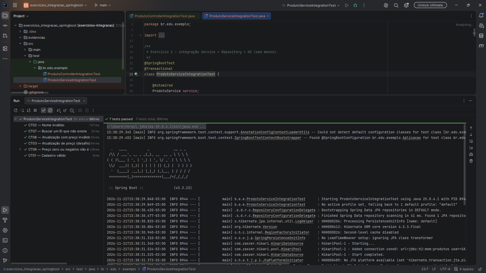
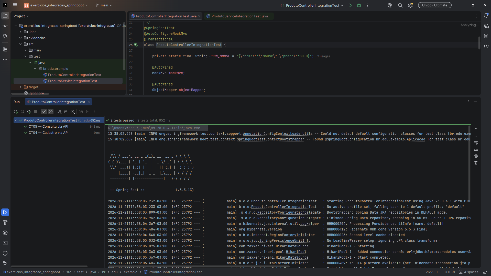

# Testes de integração com Spring Boot e JUnit 5

Projeto-base da Semana 11 (Java 17, Maven, Spring Boot 3.3.13, Spring Data JPA, H2, JUnit 5 e MockMvc).

O código de `src/main` **não foi alterado**: só os testes foram escritos. E **nenhum mock foi usado**: o `ProdutoRepository` e o `ProdutoService` são os de verdade, ligados a um banco H2 que vive só na memória.

## Como rodar

```bash
mvn test
```

## Os testes, um por um

### Exercício 1 — Service + Repository + H2 (`ProdutoServiceIntegrationTest`)

| Caso | Método | O que faz | O que confere |
|---|---|---|---|
| CT01 | `deveCadastrarERecuperarProduto` | Cadastra `Teclado` por `150.0` | O produto ganha um ID; ao buscar no repositório, nome e preço estão certos |
| CT02 | `naoDevePersistirProdutoComNomeEmBranco` | Tenta cadastrar um nome em branco | Dá `IllegalArgumentException` e a quantidade de registros não muda |
| CT03 (desafio) | `deveAtualizarPrecoPersistido` | Cadastra `Mouse` por `80.0` e muda para `95.0` | O repositório devolve o preço `95.0` |
| CT06 (extra) | `naoDevePersistirProdutoComPrecoInvalido` | Tenta cadastrar com preço `0` e `-10` | Dá `IllegalArgumentException` e nada é gravado |
| CT07 (extra) | `deveFalharAoBuscarProdutoInexistente` | Busca um ID que não existe | Dá `IllegalArgumentException` com a mensagem "Produto não encontrado" |
| CT08 (extra) | `naoDeveAtualizarParaPrecoInvalido` | Tenta atualizar o preço para `-1` | Dá erro e o banco continua com o preço `80.0` |

Nos testes que leem o banco de volta, usamos `entityManager.flush()` e depois `entityManager.clear()`. Isso manda tudo para o H2 e esvazia a memória da sessão, obrigando o `findById()` a ir mesmo até o banco.

### Exercício 2 — HTTP com MockMvc (`ProdutoControllerIntegrationTest`)

| Caso | Método | Requisição | O que confere |
|---|---|---|---|
| CT04 | `deveCadastrarProdutoPelaApi` | `POST /produtos` com `{"nome":"Mouse","preco":80.0}` | HTTP 200; `id` numérico, `nome` = `Mouse`, `preco` = `80.0` |
| CT05 | `deveBuscarProdutoPelaApi` | `POST /produtos`, pega o ID da resposta e faz `GET /produtos/{id}` | HTTP 200; o JSON da consulta bate com o do cadastro |

## Evidência da execução

Resultado do `mvn test` no IntelliJ (JDK 26, Spring Boot 3.3.13):

**Exercício 1 — ProdutoServiceIntegrationTest (CT01, CT02, CT03): 3 testes passando**



**Exercício 2 — ProdutoControllerIntegrationTest (CT04, CT05): 2 testes passando**



> As imagens acima mostram só os testes originais (CT01 a CT05). Os casos extras CT06 a CT08 foram adicionados depois e ainda não têm print.

## Discussão

### Exercício 1

**Por que `repository.findById()` prova mais do que olhar o objeto que o serviço devolveu?**
O objeto que volta de `service.cadastrar()` é o mesmo que já estava na memória, então conferir seus campos só mostra que o serviço montou o objeto direito. Quando buscamos pelo repositório, mostramos que o registro foi mesmo gravado e dá para lê-lo de volta.
Para essa prova valer, os testes fazem `flush()` e `clear()` antes. Sem isso, dentro da transação o `findById()` poderia devolver o mesmo objeto guardado na sessão, sem nem consultar o H2.

**O que o `@Transactional` faz no fim de cada teste?**
Por padrão, o Spring desfaz tudo (**rollback**) quando o teste termina. Os dados de um teste somem, então um teste não atrapalha o outro e a ordem de execução não importa.

### Exercício 2

**O que é testado de verdade?**
O caminho inteiro: o roteamento do Spring MVC, o `ProdutoController`, a conversão de JSON (Jackson), o `ProdutoService` com suas validações, o `ProdutoRepository` (Spring Data JPA), o Hibernate e o banco H2.

**Por que o MockMvc não precisa de um servidor HTTP?**
Ele chama o `DispatcherServlet` do Spring direto, dentro da mesma JVM, simulando a requisição e a resposta. Não existe porta de rede nem Tomcat, mas o Spring MVC processa tudo normalmente.

**Qual a diferença para um teste unitário do controller com dependências simuladas?**
No teste unitário, o `ProdutoService` seria um mock: só dá para ver se o controller chamou o serviço e devolveu o que ele respondeu. Aqui as dependências são as reais, então o teste também pega falhas de validação, de persistência, de mapeamento JPA e de conversão JSON, que um mock esconderia.

## Ponto de atenção (não alterado, porque `src/main` é o código-base da atividade)

Hoje, se alguém chama `POST /produtos` com nome vazio, ou `GET /produtos/{id}` com um ID que não existe, o serviço lança `IllegalArgumentException` e **ninguém trata essa exceção no controller**. Na prática a API responde **HTTP 500** (erro do servidor) em vez de **400** (pedido inválido) ou **404** (não encontrado). Em um projeto real, o certo seria um `@RestControllerAdvice` convertendo esses erros nos códigos HTTP corretos.
